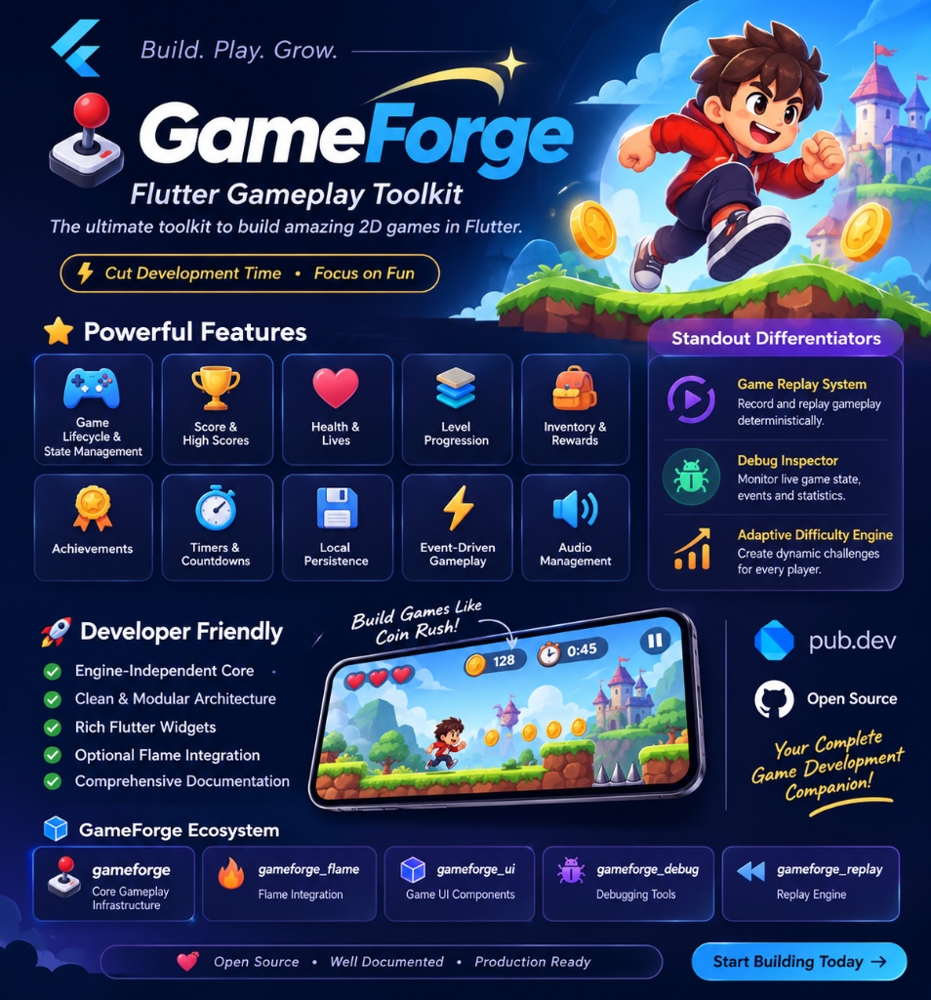

# GameForge



A modular, engine-independent Flutter gameplay toolkit for building 2D casual games, puzzle games, platformers, RPGs, and arcade experiences without repeating boilerplate.

## Overview

GameForge separates **gameplay state and rules** from rendering and UI. Every core system (`ScoreManager`, `HealthManager`, `LevelManager`, `InventoryManager`, `RewardManager`, `AchievementManager`, `GameTimerManager`, `GameSessionManager`, `GameInputHandler`, `GameEventBus`, `GameAudioService`, and `GameStorage`) is implemented in **pure Dart** with zero mandatory game-engine or storage-plugin lock-in, and can be used independently or coordinated by the central `GameForge` controller.

Flutter HUD widgets and input adapters live in an optional `package:gameforge/flutter.dart` entrypoint, and Flame (`^1.38.2`), `audioplayers` (`^6.8.1`), and `shared_preferences` (`^2.5.6`) integrations live in optional companion packages under `packages/`.

## Features

- **Core Lifecycle & Modules**: Configurable `GameForge` controller with validated `GameStatus` state transitions (`uninitialized`, `initializing`, `ready`, `running`, `paused`, `completed`, `gameOver`, `disposed`), multi-instance isolation, and extensible `GameModule` plugins.
- **Score Management**: Add, subtract, multiply, set, reset, high-score tracking, base & combo multipliers, overflow/negative validation, and immutable `ScoreState` streams.
- **Health & Lives**: Configurable health bars and/or lives, damage, healing, auto-respawn, permanent death detection, and deterministic clock-driven invincibility windows.
- **Level Progression**: Sequential, prerequisite-graph, open, and custom `LevelProgressionStrategy` implementations with star ratings, best level scores, locking/unlocking, and persistence.
- **Inventory System**: `GameItem` stack management, slot capacity, duplicate non-stackable validation, and atomic `addAll` / `transferTo` operations.
- **Rewards**: Coins, points, items, XP, custom rewards, and bundles with offer/claim queues and duplicate one-time claim prevention.
- **Achievements**: Progress tracking, custom `AchievementCondition` interfaces, idempotent unlocks, and automatic reward payouts.
- **Typed Event Bus**: `GameEventBus` supporting strongly typed events, filtered subscriptions, safe error handling, stream disposal, and cascade loop protection.
- **Timers & Deterministic Clock**: `CountdownTimer`, `StopwatchTimer`, `PeriodicTimer`, pause-aware `GameTimerManager`, and `FakeGameClock` for deterministic testing.
- **Persistence & Migrations**: Pluggable `GameStorage` interface, `MemoryGameStorage`, strict `GameSerialization`, integrity checksums on `GameSaveData`, atomic rollback on failed restore, and chained `SaveMigration` support.
- **Sessions, Input & Audio**: Active session duration tracking (excluding paused intervals), engine-independent input abstractions (`TapInputEvent`, `SwipeInputEvent`, `KeyInputEvent`, `JoystickInputEvent`, etc.), and `GameAudioService` abstraction.
- **Optional Flutter UI Layer**: `GameForgeScope`, `GameForgeBuilder`, `GameScoreWidget`, `GameHealthWidget`, `GameTimerWidget`, `GameForgeInputRegion`, and `VirtualJoystickWidget`.

## Architecture

```text
lib/
  gameforge.dart                 # Pure Dart public API (no Flutter UI dependency)
  flutter.dart                   # Flutter widgets + input adapters entrypoint
  src/
    core/                        # GameForge, GameConfig, GameStatus, GameState, GameModule, GameEventBus
    score/                       # ScoreManager, ScoreState, ScoreRules, ScoreEvent
    health/                      # HealthManager, HealthState, HealthConfig, DamageEvent
    levels/                      # LevelManager, LevelConfig, LevelProgressionStrategy, LevelState
    inventory/                   # InventoryManager, GameItem, InventoryState, InventoryEvent
    rewards/                     # RewardManager, GameReward, RewardState, RewardEvent
    achievements/                # AchievementManager, Achievement, AchievementProgress, AchievementCondition
    timer/                       # GameTimer, CountdownTimer, StopwatchTimer, PeriodicTimer, GameTimerManager
    persistence/                 # GameStorage, MemoryGameStorage, GameSaveData, SaveMigration, GameSerialization
    session/                     # GameSessionManager, SessionState, SessionStatus
    input/                       # GameInputHandler, GameInputEvent hierarchy
    audio/                       # GameAudioService, AudioSettings, Noop/RecordingGameAudioService
    utils/                       # GameClock, GameTicker, FakeGameClock, IdGenerator, Validators
    adapters/
      flutter/                   # GameForgeScope, GameForgeBuilder, GameForgeInputRegion, VirtualJoystickWidget
      widgets/                   # GameScoreWidget, GameHealthWidget, GameTimerWidget
packages/
  gameforge_flame/               # Optional Flame (^1.38.2) bridge & reactive components
  gameforge_audioplayers/        # Optional audioplayers (^6.8.1) GameAudioService implementation
  gameforge_shared_preferences/  # Optional shared_preferences (^2.5.6) GameStorage implementation
example/                         # Complete playable "Coin Rush" Flutter game
```

### Architectural Note on Optional Adapters

Rather than forcing `flame`, `audioplayers`, or `shared_preferences` into the root `gameforge` `pubspec.yaml`, third-party engine and plugin adapters live in separate optional packages under `packages/` (`gameforge_flame`, `gameforge_audioplayers`, `gameforge_shared_preferences`). This keeps `gameforge` dependency-light (`flutter` + `meta` only) while ensuring pure Dart consumers importing `package:gameforge/gameforge.dart` pull in zero UI or platform-channel dependencies.

### Allowed Lifecycle Transitions

- `uninitialized` -> `initializing`, `disposed`
- `initializing` -> `ready`, `uninitialized` (on initialization error), `disposed`
- `ready` -> `running`, `disposed`
- `running` -> `paused`, `completed`, `gameOver`, `ready` (via `restart()`), `disposed`
- `paused` -> `running`, `completed`, `gameOver`, `ready` (via `restart()`), `disposed`
- `completed` -> `ready`, `running` (via `restart()`), `disposed`
- `gameOver` -> `ready`, `running` (via `restart()`), `disposed`
- `disposed` -> terminal state (`dispose()` itself is idempotent)

## Installation

Add `gameforge` to your `pubspec.yaml`:

```yaml
dependencies:
  gameforge: ^0.1.0
```

Import the pure Dart core or the Flutter UI layer:

```dart
import 'package:gameforge/gameforge.dart'; // Pure Dart gameplay systems
import 'package:gameforge/flutter.dart';   // Includes Flutter HUD widgets & input adapters
```

## Quick Start

```dart
import 'package:gameforge/gameforge.dart';

Future<void> main() async {
  final game = GameForge(
    config: const GameConfig(
      initialLives: 3,
      initialScore: 0,
      maxLevels: 50,
    ),
  );

  await game.initialize();
  game.start();

  game.score.add(100);
  game.health.takeDamage(1);
  game.levels.unlock(2);

  await game.save();
  await game.load();

  game.pause();
  game.resume();
  game.restart();

  await game.dispose();
}
```

## API Examples

### Score Management

```dart
game.score.add(100);           // 100
game.score.multiply(2);        // 200
game.score.subtract(50);       // 150
game.score.setMultiplier(1.5); // Future add() calls apply 1.5x
game.score.incrementCombo();   // Adds combo multiplier step
game.score.reset();            // Resets currentScore (preserves highScore)
```

### Health & Lives

```dart
game.health.takeDamage(20, source: 'spike');
game.health.heal(10);
game.health.addLife();
game.health.loseLife();
game.health.grantInvincibility(const Duration(seconds: 2));
```

### Level Progression

```dart
game.levels.unlock(2);
game.levels.complete(levelId: 'level_1', stars: 3, score: 450);
game.levels.next();

// Custom non-linear progression using PrerequisiteLevelProgression:
final levels = LevelManager(
  levels: const [
    LevelConfig(id: 'hub', number: 1, unlockedByDefault: true),
    LevelConfig(id: 'forest', number: 2, prerequisiteIds: ['hub']),
    LevelConfig(id: 'boss', number: 3, prerequisiteIds: ['forest']),
  ],
  progressionStrategy: const PrerequisiteLevelProgression(),
);
```

### Inventory

```dart
game.inventory.add(
  const GameItem(id: 'coin', name: 'Gold Coin', quantity: 50),
);
game.inventory.remove('coin', quantity: 10);
final hasCoins = game.inventory.hasItem('coin', quantity: 20);
game.inventory.consume('coin', quantity: 5);

// Atomic transfer between two inventories:
playerInventory.transferTo(stashInventory, 'coin', quantity: 10);
```

### Rewards

```dart
game.rewards.grant(GameReward.coins(100));
game.rewards.grant(GameReward.points(50));
game.rewards.grant(
  GameReward.bundle(
    id: 'daily_chest',
    oneTime: true,
    rewards: [GameReward.coins(50), GameReward.experience(100)],
  ),
);
```

### Achievements

```dart
final game = GameForge(
  achievements: [
    Achievement(
      id: 'first_100_points',
      name: 'Century',
      targetValue: 100,
      reward: GameReward.coins(25, id: 'ach_100', oneTime: true),
    ),
    const Achievement(id: 'first_win', name: 'First Win', targetValue: 1),
  ],
);
await game.initialize();

game.achievements.increment('first_100_points', amount: 100);
game.achievements.unlock('first_win');
```

### Typed Event Bus

```dart
final sub = game.events.on<ScoreChangedEvent>((event) {
  // Strongly typed ScoreChangedEvent
  final score = event.newScore;
});

game.events.emit(
  DamageTakenEvent(
    requestedAmount: 10,
    appliedAmount: 10,
    previousHealth: 100,
    newHealth: 90,
  ),
);

await sub.cancel();
```

### Timers & Game Pause Behavior

Timers created or registered on `game.timers` respect `GameConfig.pauseTimersOnGamePause` (default `true`): calling `game.pause()` pauses active timers and `game.resume()` resumes only the timers paused by the game pause (manually paused timers stay paused). Calling `game.dispose()` stops all timers synchronously.

```dart
final roundTimer = game.timers.countdown(
  duration: const Duration(seconds: 60),
  autoStart: true,
  onComplete: () => game.triggerGameOver(reason: 'time_up'),
);
```

### Persistence & Save Migrations

Implement `GameStorage` for your preferred persistence backend (or use `MemoryGameStorage` / `gameforge_shared_preferences`):

```dart
class V1ToV2Migration implements SaveMigration {
  @override
  int get fromVersion => 1;

  @override
  int get toVersion => 2;

  @override
  Map<String, Object?> migrate(Map<String, Object?> data) {
    // Transform v1 schema payload into v2
    return data;
  }
}

final game = GameForge(
  config: const GameConfig(saveVersion: 2),
  storage: myStorage,
  saveMigrations: [V1ToV2Migration()],
);
```

### Custom Modules

```dart
class StaminaModule extends GameModule {
  @override
  String get id => 'stamina';

  int stamina = 100;

  @override
  void onReset() => stamina = 100;

  @override
  Map<String, Object?> toSaveData() => {'stamina': stamina};

  @override
  void fromSaveData(Map<String, Object?> data) {
    stamina = GameSerialization.readInt(data, 'stamina');
  }
}
```

### Flutter Widgets

```dart
GameForgeScope(
  game: game,
  child: Column(
    children: [
      const GameScoreWidget(showMultiplier: true, showHighScore: true),
      const GameHealthWidget(mode: GameHealthDisplayMode.both),
      GameTimerWidget(
        timer: roundTimer,
        warningThreshold: const Duration(seconds: 10),
      ),
    ],
  ),
);
```

### Optional Flame Integration (`gameforge_flame`)

```dart
class MyFlameGame extends FlameGame with GameForgeFlameMixin {
  MyFlameGame(this.gameForge);

  @override
  final GameForge gameForge;
}
```

Add reactive components such as `GameForgeScoreComponent`, `GameForgeHealthComponent`, or `GameForgeEventListenerComponent<T>` to sync Flame components cleanly with automatic subscription cleanup in `onRemove()`.

## Error Handling

All package-specific errors extend `GameException`, including:
- `InvalidLifecycleTransitionException`
- `GameConfigurationException`
- `GameEventLoopException`
- `ScoreValidationException`, `HealthValidationException`
- `LevelNotFoundException`, `LevelLockedException`
- `ItemNotFoundException`, `InsufficientItemException`, `InventoryFullException`, `DuplicateItemException`
- `RewardAlreadyClaimedException`, `AchievementNotFoundException`
- `CorruptSaveDataException`, `SaveMigrationException`, `SaveValidationException`

## Testing

Use `FakeGameClock` and `MemoryGameStorage` for fast, deterministic tests with zero arbitrary `Future.delayed` timing:

```bash
flutter test
```

See `example/` for the complete playable **Coin Rush** sample application.

## Roadmap

- Standalone published companion packages (`gameforge_flame`, `gameforge_audioplayers`, `gameforge_shared_preferences`)
- Deterministic input/event replay recorder (`gameforge_replay`)
- Live developer inspector overlay (`gameforge_debug`)
- Adaptive difficulty curves

## Contributing

Contributions are welcome! Please read [CONTRIBUTING.md](CONTRIBUTING.md) before submitting a pull request.

## License

Licensed under the MIT License. See [LICENSE](LICENSE) for details.
